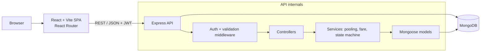
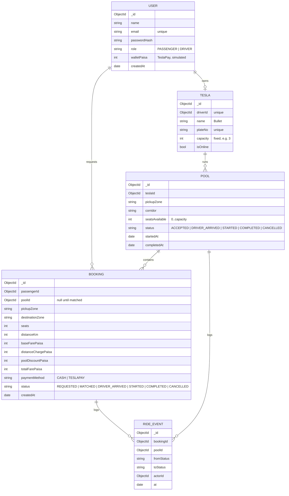
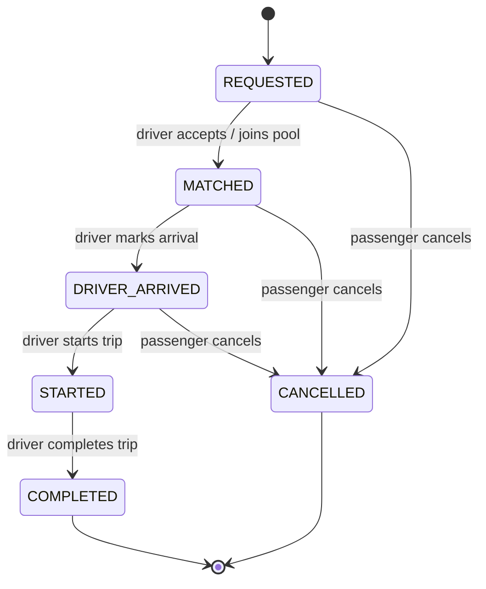

# Dhaka Tesla Pool: Architecture & Design (Phase 1)

Cast used everywhere (seed data, tests, demo): **Jashim** (driver), **Bullet** (his 3-seat Tesla), **Nusrat**, **Rafiq**, **Shirin** (passengers).

## 1. Architecture



- **Frontend:** React (Vite) + React Router. Polls the API every few seconds for status (no WebSockets in the MVP).
- **Backend:** Node.js + Express. Business rules live in `services/`, never in controllers or the UI.
- **Database:** MongoDB (Atlas free tier in production, a container in `docker compose`).
- **Docker:** `web` (static build served by nginx), `api`, `mongo`.
- **Deployment:** Vercel (frontend), Render free (API), Atlas free (DB).

No Redis, queues, microservices or Kubernetes: nothing in the MVP needs them.

## 2. Key technology decisions

| Choice | Alternatives | Why it fits | Switch when |
| --- | --- | --- | --- |
| MongoDB + Mongoose | Postgres/MySQL | A Tesla's free seats is one number; a single conditional update changes it atomically, so no multi-document transactions are needed | Heavy reporting/joins, or strict relational constraints become the main risk |
| Express | NestJS, Fastify | Small API, quick to read and explain | The codebase grows large and needs enforced module structure |
| REST | GraphQL | Few resources and fixed screens; simple to test | Many clients needing different shapes of data |
| JWT (httpOnly-free, Bearer header) | Server sessions | Stateless, simple for two roles | Need instant token revocation |
| Jest + Supertest | Vitest, Mocha | Standard for Express APIs | n/a |
| Vite + React Router | Next.js | The brief allows plain React + a router; lighter on a weak laptop | SEO/SSR needed |

## 3. Data model (ERD)



**Pool membership** is `BOOKING.poolId` (one booking belongs to at most one pool). An index on `poolId` makes "who is in this Tesla" a single query.

**Integrity rules**
- `seatsAvailable` is always between 0 and `capacity`, enforced by the schema and by the conditional update.
- A Tesla may have only one active pool at a time (partial unique index on `teslaId` where status is not COMPLETED/CANCELLED).
- One driver owns one Tesla (unique `driverId`).

**Indexes:** `USER.email` (unique), `BOOKING(passengerId, createdAt)`, `BOOKING(poolId)`, `BOOKING(status, pickupZone)`, `POOL(teslaId, status)`, `RIDE_EVENT(bookingId, at)`.

**History:** every status change writes a `RIDE_EVENT`, so we can explain exactly what happened after a ride ends.

## 4. Lifecycle



- The **driver** moves the *pool*; every booking in the pool follows it.
- Passengers can cancel any time **before STARTED**. After STARTED, cancellation is rejected.
- Any other transition is rejected with HTTP 409.

## 5. Geography and matching rule

Predefined zones, no map API. Each zone belongs to a corridor:

| Corridor | Zones |
| --- | --- |
| NORTH_EAST | Banani, Mohakhali, Gulshan 1, Bashundhara, Uttara |
| CENTRAL_WEST | Farmgate, Dhanmondi, Mirpur |

**Rule: a request can join an existing pool only if all are true**
1. Same **pickup zone** as the pool.
2. **Destination zone is in the same corridor** as the pool's first passenger.
3. Pool status is **ACCEPTED** (driver not yet arrived).
4. `seatsAvailable >= requested seats`.

Example: Nusrat (Banani to Mohakhali) and Rafiq (Banani to Gulshan 1) share a pickup zone and both destinations are NORTH_EAST, so they match. Shirin asking for Banani to Dhanmondi would not match.

**Distances** come from a fixed zone-to-zone table (assumed road km), so fares can be calculated by hand. Two pairs used in the examples: Banani to Mohakhali = 3 km, Banani to Gulshan 1 = 4 km. The full table lives in `server/src/config/zones.js`.

## 6. Fare model

Money is stored as **integer paisa** (100 paisa = 1 taka). Floats (0.1 + 0.2 problem) are avoided so totals add up exactly.

```
perSeat   = baseFare + (perKm x distanceKm)
subtotal  = perSeat x seats
discount  = floor(subtotal x 25 / 100)   // only if the pool has 2+ passengers, else 0
total     = subtotal - discount
```

Constants: `baseFare = 6000` paisa (60 taka), `perKm = 2000` paisa (20 taka), `poolDiscount = 25%`.

**Hand test (Nusrat and Rafiq, 1 seat each)**

| | Distance | Subtotal | Discount | Pooled fare | Solo fare |
| --- | --- | --- | --- | --- | --- |
| Nusrat | 3 km | 6000 + 3x2000 = 12000 | 3000 | **9000** (90 taka) | 12000 |
| Rafiq | 4 km | 6000 + 4x2000 = 14000 | 3500 | **10500** (105 taka) | 14000 |

The estimate shown at request time is the solo fare plus a note that pooling can reduce it. Fares are recalculated whenever pool membership changes before STARTED (for example if Rafiq cancels, Nusrat's discount is removed) and are **frozen at STARTED**.

Payment: CASH or simulated TeslaPay wallet. No real gateway.

## 7. Concurrency (Bullet has 1 seat left; Nusrat and Shirin both try)

Seat claim is one atomic MongoDB operation:

```js
Pool.findOneAndUpdate(
  { _id: poolId, status: 'ACCEPTED', seatsAvailable: { $gte: seats } },
  { $inc: { seatsAvailable: -seats } }
)
```

If it returns `null`, there were not enough seats and the request is rejected (or stays REQUESTED). MongoDB applies single-document updates one at a time, so exactly one of the two simultaneous calls wins. Cancelling releases seats with the matching `$inc: +seats`.

At larger scale: shard/partition by zone, use idempotency keys on booking requests, and move matching to a queue-backed service.

## 8. Assumptions

1. One Tesla has one active pool at a time.
2. Passengers join automatically on request if a matching ACCEPTED pool has space; otherwise they wait as REQUESTED until a driver accepts.
3. A driver cancelling a pool before STARTED sends its bookings back to REQUESTED.
4. Roles are PASSENGER or DRIVER, chosen at sign-up; drivers register their Tesla and capacity.
5. TeslaPay balance is simulated and only checked at completion.
6. Status updates use polling, not real-time sockets.

## 9. Scope for the MVP

In: auth, ride request, matching, pooling, per-passenger fares, driver flow, history, cancellation, tests, Docker, deployment.
Out: ratings, real maps, real payments, real-time sockets.
